# USER FLOW Nine Licious

| Field | Nilai |
| --- | --- |
| Produk | Nine Licious POS |
| Versi dokumen | 1.2 |
| Tanggal | 11 November 2026 |
| Status | Dokumentasi alur; implementasi bertahap F0–F6 |
| Sumber utama | [`docs/PRD.md`](./PRD.md) versi 1.5 dan [`docs/ROADMAP.md`](./ROADMAP.md) versi 1.5 |
| Dokumen terkait | [`README.md`](../README.md) |

> Dokumen ini menjelaskan **alur penggunaan** dari sudut pandang pelanggan dan
> setiap role. Dokumen ini tidak menambah requirement baru. Bila ada perbedaan,
> [`docs/PRD.md`](./PRD.md) tetap menjadi sumber kebenaran, sedangkan
> [`docs/ROADMAP.md`](./ROADMAP.md) menentukan fase implementasinya.

---

## Tentang dokumen ini

### Legenda status

| Label | Arti |
| --- | --- |
| ✅ **Tersedia (F0)** | Sudah berjalan pada fondasi F0 dan dapat diverifikasi sekarang |
| 🟡 **Direncanakan** | Sudah ditetapkan di PRD/ROADMAP, belum diimplementasikan |
| ⛔ **Belum diimplementasikan** | Belum ada pada F0; masuk fase yang disebutkan |
| 🚫 **Di luar scope** | Tidak boleh dibuat tanpa keputusan produk baru |

### Aktor dan role

| Aktor | Jenis | Login | Halaman awal | Tugas utama | Batasan |
| --- | --- | --- | --- | --- | --- |
| **Pelanggan** | Aktor offline, bukan akun sistem | Tidak | — | Memesan melalui kasir, membayar, menunggu, mengambil pesanan | Tidak memesan sendiri dari meja; tidak memiliki akun |
| **Kasir** | Role staf | Ya | `/pos` | Membuat pesanan, memilih meja, diskon sesuai kebijakan, pembayaran, split bill, cetak struk, konfirmasi pengambilan | Tidak dapat mengubah harga produk bebas; diskon manual perlu approval admin; refund hanya admin |
| **Kitchen** | Role staf | Ya | `/kitchen` | Melihat tiket lunas dan mengubah status KDS sampai **Siap Diambil** | Tidak melihat nominal pembayaran; tidak mengonfirmasi pengambilan; tidak mengakses POS |
| **Admin** | Role staf | Ya | `/admin` | Pengguna, menu, meja, pengaturan, approval diskon/refund, laporan, audit | Tidak dapat menonaktifkan diri sendiri atau admin aktif terakhir; aksi istimewa diaudit |
| **Publik** | Pengunjung tanpa login | Tidak | `/queue` | Melihat nomor dan status antrean | Tidak melihat nama, telepon, meja, nominal, atau metode pembayaran |

### Prinsip alur yang tidak boleh dilanggar

1. **Counter ordering.** Pelanggan memesan melalui kasir; tidak ada QR ordering,
   self-order, atau akun pelanggan.
2. **Pembayaran sebelum dapur.** Pesanan hanya masuk KDS setelah **lunas**.
3. **Nomor antrean setelah lunas.** Nomor `A001` dan tiket KDS dibuat setelah
   total pembayaran sama dengan grand total.
4. **Satu kunjungan aktif per meja.** Satu meja hanya boleh memiliki satu
   kunjungan dine-in aktif; satu kunjungan dapat memiliki beberapa pesanan.
5. **Kitchen berhenti di Siap Diambil.** Konfirmasi pengambilan hanya oleh
   kasir/admin.
6. **Approval istimewa.** Diskon manual dan refund penuh setelah lunas
   memerlukan approval admin.
7. **Privasi papan antrean.** `/queue` hanya menampilkan nomor, status, dan waktu
   pembaruan.
8. **Idempotensi.** Klik ganda, retry, dan webhook duplikat tidak boleh membuat
   pesanan, pembayaran, nomor antrean, atau tiket KDS ganda.
9. **Override bukan bypass.** Admin hanya dapat menutup meja setelah pesanan
   aktif dan pembayaran tertunda diselesaikan.

### Catatan penting tentang kondisi F0

Fondasi F0 yang **sudah tersedia**:

- login staf dengan username dan password,
- role `admin`, `kasir`, dan `kitchen`,
- guard rute, sesi idle, dan rate limit login,
- manajemen pengguna oleh admin,
- audit log aktivitas pengguna,
- halaman publik `/queue` dengan empty state,
- dashboard `/admin` dan manajemen pengguna,
- halaman `/pos` dan `/kitchen` yang masih berupa placeholder.

Halaman `/pos`, `/kitchen`, dan isi `/queue` **belum menjalankan transaksi**.
Copy lama pada placeholder masih menyebut hal-hal yang berbeda dari alur target,
misalnya:

- POS menyebut pembayaran `tunai, QRIS, kartu, atau manual` (C-02),
- POS menyiratkan tiket dikirim ke dapur sebelum pembayaran (C-03),
- kitchen memakai empat status lama (C-01/C-05),
- queue menyebut antrean muncul setelah kasir mengirim pesanan ke dapur (C-04).

Perbedaan tersebut dicatat di bagian **Konflik requirement** pada PRD dan akan
diperbaiki pada fase terkait. Alur di dokumen ini adalah **alur target** yang
mengikat, bukan klaim bahwa placeholder F0 sudah menjalankannya.

---

## Status implementasi per fase

| Area | F0 | F1.1 | F1.2 | F1.3 | F1.4 | F2 | F3 | F4 | F5 | F6 |
| --- | --- | --- | --- | --- | --- | --- | --- | --- | --- | --- |
| Login, role, guard, sesi idle, rate limit | ✅ Tersedia | — | — | — | — | — | — | — | — | — |
| Manajemen pengguna dan audit | ✅ Tersedia | — | — | — | — | — | — | — | — | — |
| Papan antrean publik | ✅ Shell/empty state | — | — | — | — | — | 🟡 Data real-time | — | — | — |
| Menu, kategori, produk, modifier | ⛔ | 🟡 | — | — | — | — | — | — | — | — |
| Denah meja, zona, editor drag-and-drop | ⛔ | — | 🟡 Wajib | — | — | — | — | — | — | — |
| Tiga status meja pada denah | ⛔ | — | 🟡 Render | 🟡 Transisi menunggu pembayaran | — | 🟡 Transisi terisi | — | — | — | — |
| POS dua bagian, keranjang, pesanan | ⛔ | — | — | 🟡 | — | — | — | — | — | — |
| Pembatalan pesanan belum lunas | ⛔ | — | — | 🟡 | — | 🟡 Sebagian dibayar | — | — | — | — |
| Handoff POS ke pembayaran | ⛔ | — | — | 🟡 Placeholder | — | 🟡 Aktif | — | — | — | — |
| Diskon produk/pesanan/manual | ⛔ | — | — | — | 🟡 | — | — | — | — | — |
| Pembayaran, split bill, struk | ⛔ | — | — | — | — | 🟡 | — | — | — | — |
| Nomor antrean dan tiket KDS | ⛔ | — | — | — | — | 🟡 Dibuat | 🟡 Ditampilkan | — | — | — |
| KDS tiga status dan pengambilan | ⛔ | — | — | — | — | — | 🟡 | — | — | — |
| Refund dan approval admin | ⛔ | — | — | — | — | 🟡 | 🟡 Notifikasi KDS | — | 🟡 Dampak kas | — |
| Stok dan bahan baku | ⛔ | — | — | — | — | — | — | 🟡 | — | — |
| Shift dan kas | ⛔ | — | — | — | — | — | — | — | 🟡 | — |
| Laporan dan export | ⛔ | — | — | — | — | — | — | — | — | 🟡 |
| QR ordering, akun pelanggan, reservasi | 🚫 | 🚫 | 🚫 | 🚫 | 🚫 | 🚫 | 🚫 | 🚫 | 🚫 | 🚫 |

**F0 saat ini hanya memiliki tabel** `profiles`, `restaurant_settings`,
`audit_logs`, `login_attempts`, dan `daily_sequences`. Tabel menu, meja,
kunjungan, pesanan, diskon, pembayaran, antrean, dan KDS belum ada.

---

## 1. Customer Flow

### 1.1 Status

| Bagian | Status |
| --- | --- |
| Melihat papan antrean publik | ✅ Tersedia di `/queue` (empty state pada F0) |
| Melihat menu dan memesan melalui kasir | 🟡 F1.1 (menu), F1.3 (pesanan) |
| Membayar dan menerima nomor antrean | 🟡 F2 |
| Melihat status real-time dan mengambil pesanan | 🟡 F3 |

Pelanggan **bukan role login**. Pelanggan berinteraksi secara offline dengan
kasir dan tidak memiliki akun, riwayat pesanan mandiri, atau akses ke data
pembayaran.

### 1.2 Alur normal

1. Pelanggan datang ke area kasir.
2. Pelanggan menyampaikan tipe pesanan: **dine-in** atau **takeaway**.
3. Untuk dine-in, kasir memilih meja pada denah. Untuk takeaway, tidak ada meja
   dan tidak ada kunjungan dine-in.
4. Pelanggan menyampaikan produk, modifier, jumlah, dan catatan khusus.
5. Kasir menampilkan ringkasan: subtotal, diskon, pajak, service charge, grand
   total, jumlah yang sudah dibayar, dan sisa pembayaran.
6. Bila ada diskon manual, kasir mengajukan approval admin. Diskon yang belum
   disetujui tidak diterapkan. Diskon manual harus disetujui sebelum pesanan
   disimpan atau pembayaran diproses.
7. Kasir menyimpan pesanan. Pesanan berstatus **Menunggu Pembayaran**; belum ada
   nomor antrean dan belum masuk KDS.
8. Pada F1, alur berhenti pada konfirmasi **Menunggu Pembayaran**; CTA
   pembayaran masih placeholder dan belum ada pembayaran yang dicatat. Pada F2,
   pelanggan membayar dan pembayaran dapat penuh atau split bill.
9. Bila total pembayaran belum sama dengan grand total, pesanan menjadi
   **Sebagian Dibayar**; belum ada nomor antrean dan belum masuk KDS.
10. Setelah lunas, pelanggan menerima struk/nomor antrean. Nomor antrean muncul
    di papan publik.
11. Pelanggan menunggu sampai status **Siap Diambil**.
12. Pelanggan mengambil pesanan.
13. Kasir/admin mengonfirmasi pengambilan. Pesanan menjadi **Selesai** dan hilang
    dari KDS/papan antrean.
14. Untuk dine-in, kasir/admin menutup kunjungan dan mengosongkan meja setelah
    semua pesanan selesai/dibatalkan/direfund dan tidak ada pembayaran tertunda.

### 1.3 Diagram

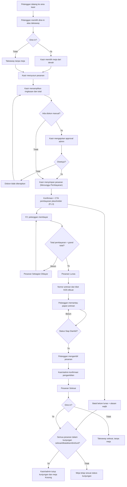

### 1.4 Kondisi berhasil, gagal, dan batal

| Kondisi | Hasil |
| --- | --- |
| **Berhasil** | Pesanan lunas, nomor antrean dibuat, pelanggan mengambil pesanan, kasir/admin mengonfirmasi, pesanan **Selesai** |
| **Pembayaran gagal/expired** | Tidak ada nomor antrean dan tidak ada tiket KDS; pesanan tetap belum lunas dan dapat dibayar ulang |
| **Pembayaran sebagian** | Pesanan **Sebagian Dibayar**; belum masuk KDS; sisa tagihan ditampilkan |
| **Pelanggan membatalkan sebelum bayar** | Pesanan **Dibatalkan** oleh kasir/admin dengan alasan wajib dan audit; tidak ada antrean/KDS; meja **Kosong** hanya bila tidak ada pesanan aktif lain/pembayaran tertunda |
| **Handoff F1** | Konfirmasi **Menunggu Pembayaran** + CTA placeholder; pelanggan belum membayar di sistem; F2 memakai pesanan yang sama |
| **Pembatalan setelah lunas** | Mengikuti **Refund and Cancellation Flow**, bukan pembatalan biasa |
| **Diskon manual ditolak** | Diskon tidak diterapkan; kasir dapat mengubah diskon atau melanjutkan tanpa diskon manual |

---

## 2. Cashier Flow

### 2.1 Status

| Bagian | Status |
| --- | --- |
| Login dan guard role | ✅ F0 |
| Denah meja dan pemilihan meja | 🟡 F1.2/F1.3 |
| POS, keranjang, simpan pesanan | 🟡 F1.3 |
| Pembatalan pesanan belum lunas | 🟡 F1.3 |
| Handoff ke pembayaran | 🟡 F1.3 placeholder, aktif F2 |
| Diskon produk/pesanan/manual | 🟡 F1.4 |
| Pembayaran, split bill, struk, nomor antrean | 🟡 F2 |
| Konfirmasi pengambilan | 🟡 F3 |

### 2.2 Alur normal

1. Kasir login di `/login`. Setelah valid, kasir diarahkan ke `/pos`.
2. Kasir membuka POS dan memilih **Dine-in** atau **Takeaway**.
3. Untuk dine-in, kasir memilih meja dari denah:
   - meja **Kosong** membuka kunjungan dine-in baru;
   - meja **Terisi** dengan semua pesanan lunas (F2) dapat dipilih untuk pesanan
     tambahan pada kunjungan yang sama;
   - meja **Menunggu Pembayaran** dengan pesanan belum lunas berarti item
     ditambahkan ke pesanan tersebut, bukan membuat pesanan baru.
4. Kasir mencari produk, menambahkan ke keranjang, lalu mengatur modifier,
   jumlah, dan catatan khusus.
5. Kasir menerapkan diskon produk/pesanan sesuai kebijakan. Diskon manual
   memerlukan alasan dan approval admin. Kasir tidak dapat mengubah harga
   produk secara bebas.
6. Kasir memeriksa subtotal, diskon, pajak, service charge, grand total, jumlah
   yang sudah dibayar, dan sisa pembayaran.
7. Kasir menyimpan pesanan. Sistem membuat pesanan **Menunggu Pembayaran**.
   Untuk dine-in, sistem membuka/memakai kunjungan dan mengubah meja menjadi
   **Menunggu Pembayaran**. Belum ada nomor antrean atau tiket KDS.
8. **F1 berhenti di sini.** Sistem menampilkan konfirmasi **Menunggu
   Pembayaran** dengan CTA pembayaran nonaktif/placeholder. Kasir dapat kembali
   ke POS/denah atau membatalkan pesanan belum lunas dengan alasan wajib.
   F1 tidak mencatat pembayaran.
9. **F2** memakai `order_id` yang sama untuk memproses pembayaran, baik penuh
   maupun split bill. F2 tidak membuat pesanan atau kunjungan baru.
10. Bila pembayaran belum memenuhi grand total, pesanan menjadi **Sebagian
    Dibayar** dan kasir dapat melanjutkan pembayaran.
11. Setelah total pembayaran sama dengan grand total, pesanan menjadi **Lunas**.
    Sistem membuat nomor antrean dan tiket KDS tepat sekali.
12. Kasir mencetak struk/nomor antrean melalui browser print (58 mm atau 80 mm).
    Cetak ulang dicatat di audit.
13. Saat tiket berstatus **Siap Diambil**, kasir/admin mengonfirmasi pengambilan.
    Pesanan menjadi **Selesai** dan tiket hilang dari KDS/papan antrean.
14. Kasir/admin menutup kunjungan dan mengosongkan meja setelah semua pesanan
    selesai/dibatalkan/direfund dan tidak ada pembayaran tertunda.

### 2.3 Diagram

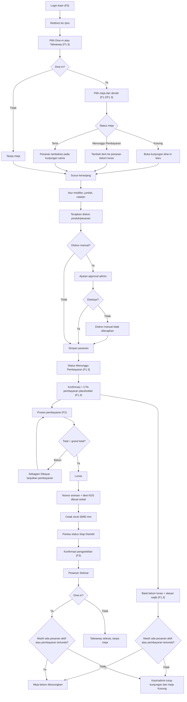

### 2.4 Kondisi berhasil, gagal, dan batal

| Kondisi | Hasil |
| --- | --- |
| **Berhasil menyimpan pesanan** | Pesanan **Menunggu Pembayaran**; untuk dine-in, meja **Menunggu Pembayaran**; belum ada KDS/antrean |
| **Klik ganda/retry simpan** | Idempotency key mengembalikan pesanan yang sama; tidak ada pesanan ganda |
| **Diskon manual belum disetujui** | Tidak boleh diterapkan; kasir harus menunggu approval atau melanjutkan tanpa diskon |
| **Pembayaran gagal/expired** | Pesanan tetap belum lunas; tidak ada antrean/KDS; kasir dapat mencoba lagi |
| **Pembayaran non-tunai melebihi sisa** | Ditolak; kasir harus memasukkan nominal yang valid |
| **Uang tunai melebihi sisa** | Diterima; selisih dicatat sebagai kembalian, bukan nilai pembayaran |
| **Pesanan belum lunas** | Tidak boleh membuat nomor antrean atau tiket KDS |
| **Kitchen mencoba konfirmasi pengambilan** | Ditolak; aksi hanya untuk kasir/admin |
| **Menutup meja dengan pesanan aktif/pembayaran tertunda** | Ditolak; admin harus membatalkan pesanan belum lunas atau merefund penuh pesanan lunas yang masih aktif, lalu menutup meja dengan konfirmasi dan audit |
| **Pesanan dibatalkan sebelum bayar** | Pesanan **Dibatalkan**; kasir/admin wajib memilih alasan; audit tercatat; untuk dine-in, meja **Kosong** hanya bila tidak ada pesanan aktif lain/pembayaran tertunda |
| **Kitchen mencoba membatalkan pesanan** | Ditolak; pembatalan hanya untuk kasir/admin |
| **Pembatalan pesanan Sebagian Dibayar** | Ditolak pada F1; F2 hanya setelah refund bagian disetujui dan dicatat admin |
| **Handoff F1 ke pembayaran** | Konfirmasi **Menunggu Pembayaran** + CTA placeholder; tidak ada pembayaran/KDS/antrean; kasir dapat kembali ke POS/denah |

---

## 3. Kitchen Flow

### 3.1 Status

| Bagian | Status |
| --- | --- |
| Login dan guard role | ✅ F0 |
| Halaman KDS | ⛔ Placeholder; 🟡 F3 |
| Tiket KDS dari pesanan lunas | 🟡 F2 (data), F3 (tampilan) |
| Tiga status KDS | 🟡 F3 |
| Notifikasi refund | 🟡 F2 (pencatatan), F3 (tampilan) |

### 3.2 Alur normal

1. Staf kitchen login dan diarahkan ke `/kitchen`.
2. Kitchen hanya melihat tiket dari pesanan yang sudah **Lunas**. Pesanan
   **Menunggu Pembayaran** atau **Sebagian Dibayar** tidak pernah muncul.
3. Bila filter stasiun dikonfigurasi, kitchen hanya melihat item yang relevan;
   bila belum dikonfigurasi, semua item ditampilkan.
4. Tiket menampilkan nomor antrean, tipe pesanan, nomor meja untuk dine-in,
   item, modifier, catatan, serta waktu masuk/mulai/siap.
5. Kitchen memulai penyiapan: **Pesanan Masuk → Sedang Disiapkan**. Waktu mulai
   dicatat.
6. Kitchen menandai selesai: **Sedang Disiapkan → Siap Diambil**. Waktu siap
   dicatat.
7. Kitchen berhenti di **Siap Diambil**. Kitchen tidak memiliki aksi
   **Selesai**, **Diambil**, atau konfirmasi pengambilan.
8. Kasir/admin mengonfirmasi pengambilan. Tiket dihapus dari KDS dan pesanan
   menjadi **Selesai**.
9. Bila refund penuh setelah pesanan lunas disetujui admin dan tiket masih
   aktif, tiket dihentikan, dihapus dari papan aktif, dan kitchen menerima
   notifikasi penghentian tiket. Ini bukan status KDS keempat.

### 3.3 Diagram

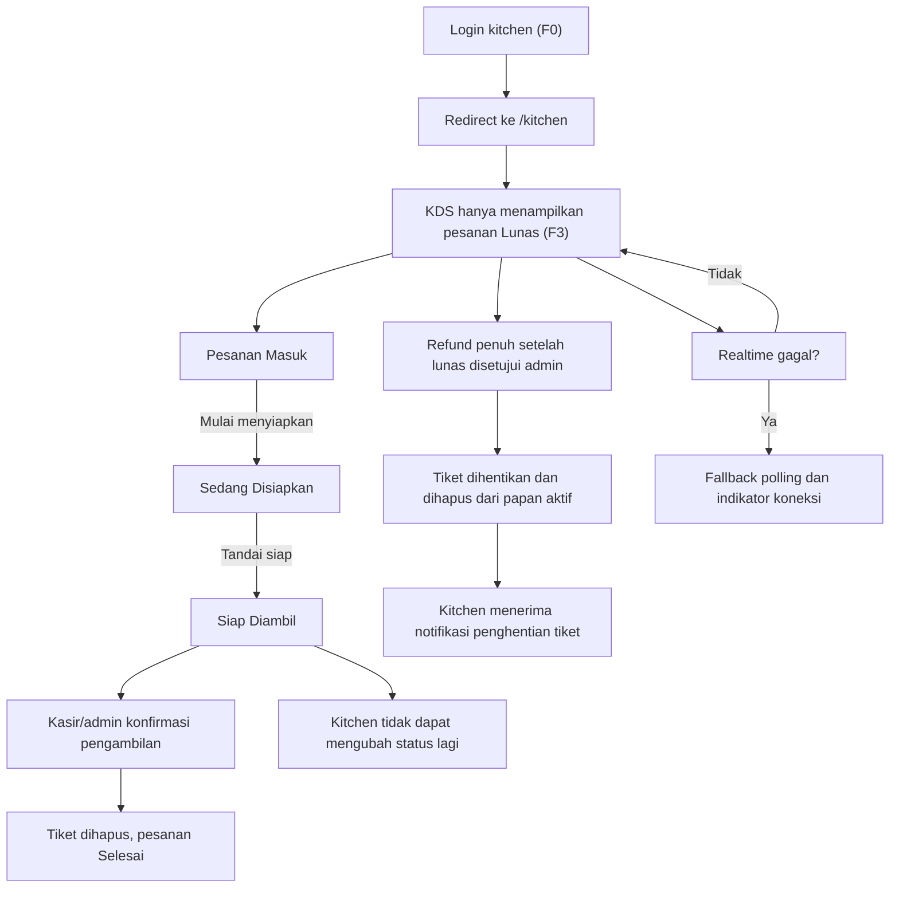

### 3.4 Kondisi berhasil, gagal, dan batal

| Kondisi | Hasil |
| --- | --- |
| **Berhasil** | Tiket bergerak tepat satu langkah: Masuk → Disiapkan → Siap Diambil |
| **Pesanan belum lunas** | Tidak muncul di KDS |
| **Perpindahan status melompat** | Ditolak di server |
| **Kitchen mencoba mengubah setelah Siap Diambil** | Ditolak; aksi pengambilan hanya kasir/admin |
| **Realtime gagal** | Fallback polling; indikator koneksi ditampilkan |
| **Refund penuh setelah lunas, tiket masih aktif** | Tiket dihentikan, kitchen diberi notifikasi, pesanan **Refund** |
| **Refund sebagian** | Tiket KDS tidak berubah |

---

## 4. Admin Flow

### 4.1 Status

| Bagian | Status |
| --- | --- |
| Login, dashboard, pengguna, audit | ✅ F0 |
| Menu, kategori, produk, modifier | 🟡 F1.1 |
| Meja, zona, editor denah | 🟡 F1.2 |
| Pemantauan pesanan dan pembatalan belum lunas | 🟡 F1.3 |
| Approval diskon manual | 🟡 F1.4 |
| Refund dan pemantauan pembayaran | 🟡 F2 |
| Pemantauan KDS/antrean, override meja | 🟡 F3 |
| Stok dan resep | 🟡 F4 |
| Shift dan kas | 🟡 F5 |
| Laporan, export, audit lanjutan | 🟡 F6 |

### 4.2 Alur normal per fase

**F0 — yang sudah berjalan**

1. Admin login dan diarahkan ke `/admin`.
2. Admin melihat ringkasan staf, pajak, service charge, sesi idle, dan kesiapan
   sistem.
3. Admin membuka `/admin/users` untuk membuat akun staf, memilih role,
   mereset password, serta mengaktifkan/menonaktifkan akun.
4. Admin tidak dapat menonaktifkan akunnya sendiri atau admin aktif terakhir.
5. Semua aktivitas pengelolaan akun dicatat di audit log.

**F1.1 — Menu & Master Data**

1. Admin mengelola kategori Food/Drinks/Desserts/Packages.
2. Admin membuat produk dengan foto, nama, harga, modifier, status aktif,
   ketersediaan, dan stasiun dapur opsional.
3. Admin mengelola grup/opsi modifier dan menghubungkannya ke produk.

**F1.2 — Meja & Denah**

1. Admin mengatur zona, meja, kapasitas, posisi x/y, bentuk, dan layout melalui
   editor **drag-and-drop**. Layout disimpan dan diterbitkan.
2. Admin dapat melihat status meja: Kosong, Menunggu Pembayaran, Terisi. Ketiga
   status ter-render pada F1.2; transisi nyata ke Terisi diuji pada F2.

**F1.3 — POS Core, Kunjungan & Pesanan**

1. Admin dapat memantau pesanan **Menunggu Pembayaran** dan membatalkannya
   dengan alasan wajib bila belum ada pembayaran.
2. Admin dapat menutup kunjungan dan mengosongkan meja setelah semua pesanan
   dibatalkan dan tidak ada pembayaran tertunda.
3. Admin tidak dapat menandai pesanan lunas, membuat nomor antrean, atau
   membuat tiket KDS pada F1.

**F1.4 — Diskon & Finalisasi**

1. Admin menyetujui atau menolak diskon manual yang diajukan kasir.
2. Diskon yang belum disetujui tidak diterapkan; approval, penolakan, alasan,
   dan approver dicatat di audit.

**F2 — pembayaran dan refund**

1. Admin dapat meninjau detail pembayaran, split bill, dan sumber pembayaran
   melalui detail transaksi serta audit log.
2. Admin membuat dan menyetujui refund. Kasir hanya melihat status.
3. Refund penuh setelah pesanan lunas memerlukan approval admin.
4. Admin dapat mencetak ulang struk/nomor antrean; cetak ulang diaudit.

**F3 — KDS dan antrean**

1. Admin dapat memantau KDS dan papan antrean.
2. Admin dapat mengonfirmasi pengambilan seperti kasir.
3. Admin dapat melakukan override penutupan meja setelah membatalkan pesanan
   belum lunas, menyelesaikan pembayaran tertunda, atau merefund penuh pesanan
   lunas yang masih aktif; konfirmasi dan seluruh aksi dicatat di audit.
4. Admin melihat status refund dan audit penghentian tiket akibat refund.

**F4–F6**

- **F4:** bahan baku, resep, pengurangan stok, penyesuaian stok, peringatan stok
  rendah, laporan pemakaian.
- **F5:** buka/tutup shift, kas awal/akhir, kas masuk/keluar, rekonsiliasi,
  dampak refund tunai.
- **F6:** laporan penjualan, kategori/produk, pembayaran/split bill, refund,
  stok, shift, export CSV/Excel, filter audit.

### 4.3 Diagram

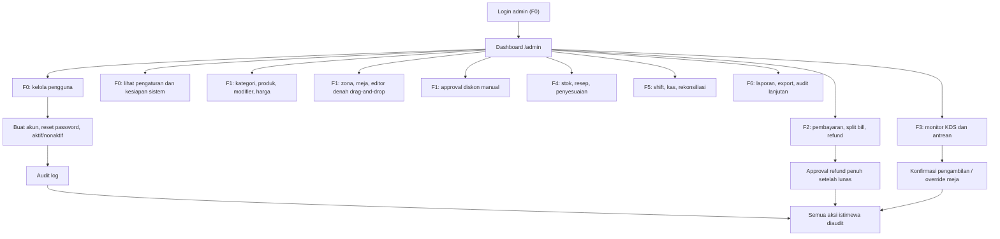

### 4.4 Kondisi berhasil, gagal, dan batal

| Kondisi | Hasil |
| --- | --- |
| **Berhasil** | Perubahan master data/approval tersimpan dan diaudit |
| **Non-admin membuka `/admin`** | Ditolak dan diarahkan ke `/unauthorized` |
| **Menonaktifkan diri sendiri** | Ditolak |
| **Menonaktifkan admin aktif terakhir** | Ditolak |
| **Approval diskon/refund oleh non-admin** | Ditolak di server |
| **Override tutup meja** | Hanya setelah semua pesanan diselesaikan; konfirmasi dan audit |
| **Perubahan harga produk** | Hanya admin melalui master produk; transaksi lama memakai snapshot |

---

## 5. Order Flow

### 5.1 Status

| Bagian | Status |
| --- | --- |
| Pesanan, item, modifier, kunjungan | 🟡 F1.3 |
| Diskon produk/pesanan/manual | 🟡 F1.4 |
| Pembatalan pesanan belum lunas | 🟡 F1.3 (tanpa pembayaran), F2 (sebagian dibayar) |
| Handoff ke pembayaran | 🟡 F1.3 placeholder, F2 aktif |
| Pembayaran dan perubahan status lunas | 🟡 F2 |
| Tiket KDS dan status dapur | 🟡 F2 (data), F3 (tampilan) |

### 5.2 Alur status pesanan

1. Pesanan disimpan sebagai **Menunggu Pembayaran**. Belum ada KDS/antrean.
2. **F1 berhenti di sini.** Sistem menampilkan konfirmasi **Menunggu
   Pembayaran** dan CTA pembayaran nonaktif/placeholder. F1 tidak mencatat
   pembayaran dan tidak mengubah pesanan menjadi **Lunas**.
3. **F2** memakai `order_id` yang sama untuk pembayaran penuh atau split bill;
   F2 tidak membuat pesanan/kunjungan baru.
4. Pembayaran penuh membuat pesanan **Lunas**. Pembayaran sebagian membuat
   pesanan **Sebagian Dibayar**; setelah sisa dibayar, status menjadi **Lunas**.
5. Pada F1, pesanan **Menunggu Pembayaran** tanpa pembayaran dapat dibatalkan
   oleh kasir/admin dengan alasan wajib dan audit. Kitchen tidak dapat
   membatalkan. Pesanan **Dibatalkan** bersifat final.
6. Pembatalan pesanan **Sebagian Dibayar** baru dijalankan pada F2 setelah
   refund bagian disetujui dan dicatat admin.
7. Pesanan **Lunas** dapat menjadi **Selesai** setelah pengambilan dikonfirmasi,
   atau **Refund** bila refund penuh dicatat. Pesanan **Selesai** juga dapat
   menjadi **Refund** bila refund penuh dicatat setelah pengambilan.
8. Pesanan yang sudah **Lunas** tidak boleh menjadi **Dibatalkan**; pembatalan
   setelah lunas dicatat sebagai **Refund** penuh.
9. Status pesanan dan status KDS adalah dua hal berbeda. Pesanan **Lunas** dapat
   memiliki status KDS apa pun.
10. Dampak pembatalan terhadap meja: meja kembali **Kosong** hanya bila tidak ada
    pesanan aktif lain dan tidak ada pembayaran tertunda; bila ada, status meja
    mengikuti pesanan yang tersisa.

### 5.3 Diagram

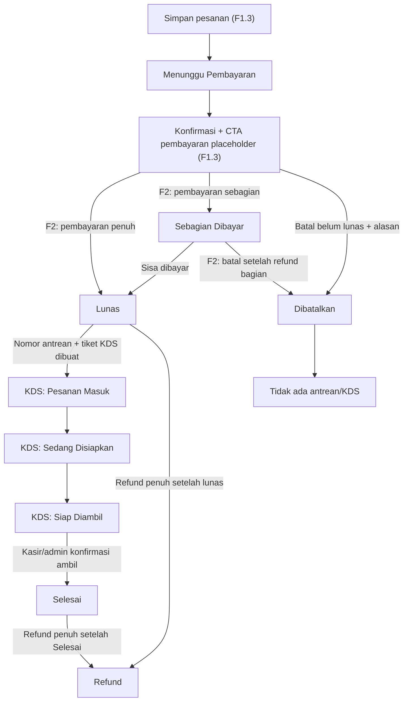

### 5.4 Perpindahan data pesanan

| Tahap | Data yang ditulis/dibaca | Status fase |
| --- | --- | --- |
| Simpan pesanan | `orders`, `order_items`, `order_item_modifiers`, `dining_sessions` | F1.3 |
| Diskon | `order_discounts`, status approval, approver, snapshot | F1.4 |
| Pembatalan belum lunas | `orders.status = dibatalkan`, `cancelled_at`, `cancelled_by`, `cancel_reason`, audit | F1.3/F2 |
| Handoff pembayaran | `order_id`, status **Menunggu Pembayaran**; tanpa baris pembayaran | F1.3 |
| Pembayaran | `payments`, nominal, metode, sumber, referensi, status | F2 |
| Lunas | `orders.paid_total`, `payment_status`, `queue_number`, `queue_date` | F2 |
| Tiket KDS | Data tiket/status KDS, waktu masuk/mulai/siap | F2/F3 |
| Pengambilan | `orders.status = selesai`, tiket dihapus dari papan | F3 |
| Refund | `refunds`, status approval, alasan, approver, notifikasi dapur | F2/F3 |

### 5.5 Kondisi berhasil, gagal, dan batal

| Kondisi | Hasil |
| --- | --- |
| **Berhasil** | Status berpindah sesuai state machine dan tercatat |
| **Transisi tidak valid** | Ditolak di server |
| **Pesanan belum lunas** | Tidak boleh masuk KDS atau memiliki nomor antrean |
| **Klik ganda/retry** | Idempotency mencegah pesanan ganda |
| **Pesanan batal sebelum bayar** | **Dibatalkan**; alasan wajib; audit; tidak ada KDS/antrean |
| **Pembatalan oleh kitchen** | Ditolak |
| **Pembatalan setelah pembayaran sebagian** | F2: **Dibatalkan** setelah refund bagian disetujui/dicatat admin; tidak ada KDS/antrean |
| **Pembatalan setelah lunas** | Wajib melalui refund, bukan **Dibatalkan** |
| **Pembatalan dengan pesanan aktif lain** | Meja tidak dikosongkan; status mengikuti pesanan yang tersisa |
| **Pembatalan tanpa pesanan aktif/pembayaran tertunda** | Kunjungan dapat ditutup dan meja **Kosong** |
| **Handoff F1** | Konfirmasi **Menunggu Pembayaran** + CTA placeholder; tidak ada pembayaran/KDS/antrean |
| **Refund sebagian** | Pesanan tetap **Lunas** atau **Selesai**; KDS tidak berubah |

---

## 6. Payment Flow

### 6.1 Status

| Bagian | Status |
| --- | --- |
| Konfigurasi Midtrans | ✅ Helper/config F0; belum aktif untuk transaksi |
| Handoff pesanan dari F1.3 | 🟡 F1.3 placeholder, F2 aktif |
| Pembayaran tunai, QRIS Manual, transfer | 🟡 F2 |
| QRIS Midtrans dan Midtrans Snap | 🟡 F2 |
| Split bill | 🟡 F2 |
| Pembatalan pesanan **Sebagian Dibayar** setelah refund bagian | 🟡 F2 |
| Struk browser print 58/80 mm | 🟡 F2 |

**Status pembayaran:**

| Status | Arti |
| --- | --- |
| **Belum Dibayar** | Belum ada pembayaran |
| **Sebagian** | Total pembayaran < grand total; belum ada refund |
| **Lunas** | Total pembayaran = grand total; belum ada refund |
| **Refund Sebagian** | Sebagian pembayaran yang tercatat dikembalikan; masih ada dana yang tidak direfund |
| **Refund Penuh** | Seluruh pembayaran yang tercatat dikembalikan; tidak ada dana tersisa |

Status pembayaran **Sebagian** berbeda dari status pesanan **Sebagian Dibayar**;
keduanya menunjukkan total pembayaran belum mencapai grand total. Status
pembayaran mengikuti dana yang tercatat, bukan status pesanan: pesanan
**Dibatalkan** sebelum lunas yang seluruh pembayaran sebagiannya dikembalikan
memakai status pembayaran **Refund Penuh**.

### 6.2 Metode dan sumber pembayaran

| Metode | Sumber/channel | Sifat | Catatan |
| --- | --- | --- | --- |
| Tunai | `cash` | Manual | Kasir menerima uang; sistem menghitung kembalian |
| QRIS Manual | `qris_manual` | Manual | QRIS statis; kasir mengonfirmasi dan mencatat referensi |
| QRIS Midtrans | `qris_midtrans` | Gateway | Status valid setelah webhook terverifikasi |
| Transfer | `bank_transfer` | Manual | Kasir mencatat referensi dan mengonfirmasi |
| Midtrans | `midtrans_snap` | Gateway | Kartu/e-wallet sesuai channel yang diaktifkan |

**QRIS Manual** dan **QRIS Midtrans** adalah dua sumber berbeda. Metode `kartu`
tidak menjadi metode terpisah; kartu diproses melalui Midtrans bila channel
tersebut diaktifkan.

**Urutan perhitungan:** diskon produk per baris → diskon pesanan → diskon
manual → pajak dan service charge → grand total. Pajak dan service charge
dihitung dari dasar setelah seluruh diskon. Total diskon tidak boleh melebihi
subtotal sebelum diskon dan grand total tidak boleh negatif.

**Environment Midtrans:** development hanya boleh memakai Sandbox; production
hanya boleh memakai Production. Data uji Sandbox tidak boleh masuk laporan
operasional production.

### 6.3 Alur normal

1. F2 membuka pesanan **Menunggu Pembayaran** hasil handoff F1.3 dengan
   `order_id` yang sama; F2 tidak membuat pesanan atau kunjungan baru.
2. Sistem menampilkan grand total dan sisa tagihan.
3. Kasir memilih metode dan sumber pembayaran.
4. **Tunai:** kasir memasukkan uang yang diterima. Nilai pembayaran yang dicatat
   adalah nominal yang dialokasikan untuk pesanan, maksimal sebesar sisa
   tagihan. Bila uang diterima melebihi sisa tagihan, kembalian = uang diterima −
   sisa tagihan; kelebihan tunai bukan nilai pembayaran.
5. **QRIS Manual/Transfer:** kasir mengonfirmasi pembayaran dan mencatat
   referensi.
6. **QRIS Midtrans/Midtrans:** sistem membuat transaksi gateway dengan
   `midtrans_order_id` unik. Setiap bagian pembayaran online pada split bill
   memakai transaksi gateway sendiri.
7. Pembayaran online hanya dianggap berhasil setelah webhook diverifikasi:
   signature valid dan status transaksi diambil ulang dari API Midtrans.
   Callback Snap di browser bukan bukti pembayaran.
8. Webhook duplikat diproses idempoten; tidak boleh membuat pembayaran ganda.
9. Bila total pembayaran belum sama dengan grand total, pesanan menjadi
   **Sebagian Dibayar**. Non-tunai tidak boleh melebihi sisa tagihan.
10. Bila total pembayaran sama dengan grand total, pesanan menjadi **Lunas**
    secara atomik. Nomor antrean dan tiket KDS dibuat tepat sekali.
11. Kasir mencetak struk melalui browser print 58 mm atau 80 mm. Struk memuat
    rincian diskon, sumber pembayaran, kembalian, dan approver diskon manual bila
    ada. Integrasi ESC/POS tidak wajib pada F2.

### 6.4 Diagram

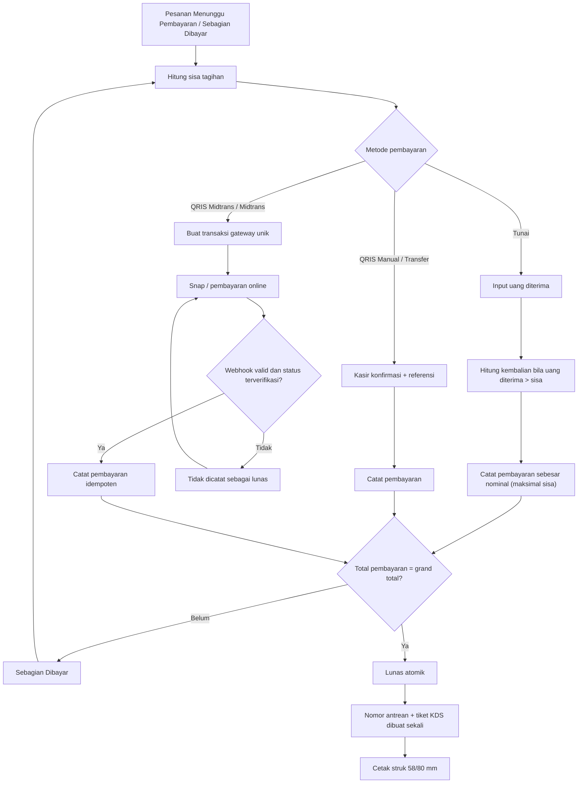

### 6.5 Kondisi berhasil, gagal, dan batal

| Kondisi | Hasil |
| --- | --- |
| **Berhasil tunai** | Pembayaran dicatat sebesar nominal yang dialokasikan (maksimal sisa); kembalian dihitung dan dicatat terpisah |
| **Pesanan hasil handoff F1** | Dibayar memakai `order_id` yang sama; tidak membuat pesanan/kunjungan baru |
| **Pembatalan pesanan Sebagian Dibayar** | Hanya setelah refund bagian disetujui/dicatat admin; pesanan **Dibatalkan**; tidak ada antrean/KDS |
| **Berhasil QRIS Manual/transfer** | Pembayaran dicatat setelah kasir mengonfirmasi dan mengisi referensi |
| **Berhasil Midtrans** | Pembayaran dicatat setelah signature valid dan status diverifikasi |
| **Webhook invalid** | Pembayaran tidak dianggap lunas |
| **Webhook duplikat** | Idempoten; tidak ada pembayaran ganda |
| **Pembayaran online gagal/expired** | Pesanan tetap belum lunas; tidak ada antrean/KDS |
| **Pembayaran non-tunai melebihi sisa** | Ditolak |
| **Uang tunai melebihi sisa** | Diterima; selisih menjadi kembalian |
| **Total pembayaran melebihi grand total** | Ditolak; nilai pembayaran tidak boleh melebihi tagihan |
| **Split bill belum penuh** | **Sebagian Dibayar**; belum masuk KDS |
| **Split bill penuh** | **Lunas**; antrean/KDS dibuat sekali |

---

## 7. Table Management Flow

### 7.1 Status

| Bagian | Status |
| --- | --- |
| Denah meja interaktif | 🟡 F1.2 — **challenge wajib** |
| Editor drag-and-drop posisi, kapasitas, zona | 🟡 F1.2 |
| Tiga status meja ter-render | 🟡 F1.2 |
| Transisi meja ke **Menunggu Pembayaran** dan kembali **Kosong** setelah pembatalan | 🟡 F1.3 |
| Pemilihan meja oleh kasir | 🟡 F1.3 |
| Transisi nyata ke **Terisi** | 🟡 F2 |
| Penutupan meja | 🟡 F1.3/F2/F3 |

> Denah meja interaktif adalah **challenge pembimbing** dan wajib
> dipertahankan. Fitur ini tidak boleh dihapus atau ditunda tanpa persetujuan
> pembimbing.
>
> **Batas milestone:** F1.2 hanya membuktikan denah dapat merender tiga status.
> Transisi nyata ke **Menunggu Pembayaran** diuji di F1.3, sedangkan transisi
> ke **Terisi** diuji di F2 karena memerlukan pembayaran.

### 7.2 Alur admin

1. Admin membuka pengelolaan meja.
2. Admin mengatur zona/area. Zona wajib dipilih; default **Utama** bila belum
   diatur. Admin dapat menambah, mengubah nama, mengatur urutan, dan
   menonaktifkan zona selama zona tersebut tidak memiliki meja aktif.
3. Admin menambah/mengubah/menonaktifkan meja.
4. Admin mengatur nomor/nama, kapasitas, bentuk/ukuran opsional, dan posisi x/y.
5. Admin menggeser meja dengan **drag-and-drop**.
6. Admin menyimpan dan menerbitkan layout.
7. Admin dapat melihat status meja secara real-time.
8. Meja yang sudah memiliki riwayat pesanan tidak dihapus permanen; gunakan
   status aktif/nonaktif.

### 7.3 Alur kasir

1. Kasir membuka denah dari POS.
2. Kasir memilih meja:
   - **Kosong** → buka kunjungan dine-in baru;
   - **Terisi** dan semua pesanan aktif sudah lunas → pesanan tambahan pada
     kunjungan yang sama;
   - **Menunggu Pembayaran** dan masih ada pesanan belum lunas → tambah item ke
     pesanan tersebut, bukan membuat pesanan baru;
   - meja dengan kunjungan aktif tidak boleh dipakai untuk kunjungan baru yang
     tidak terkait.
3. Pesanan dine-in menyimpan `table_id` dan `dining_session_id`.
4. Satu meja hanya memiliki satu kunjungan aktif; satu kunjungan dapat memiliki
   beberapa pesanan.
5. **F1.3:** meja berubah **Menunggu Pembayaran** saat ada pesanan belum lunas.
6. **F2:** meja berubah **Terisi** saat semua pesanan aktif lunas. F1 tidak
   boleh menandai pesanan lunas, sehingga transisi ini tidak diuji di F1.
7. Pesanan tambahan yang belum lunas mengembalikan meja ke **Menunggu
   Pembayaran**.
8. Pembatalan pesanan belum lunas pada F1.3 wajib alasan dan audit. Bila tidak
   ada pesanan aktif lain dan tidak ada pembayaran tertunda, kasir/admin dapat
   menutup kunjungan dan meja kembali **Kosong**; bila ada, status meja
   mengikuti pesanan yang tersisa.
9. Kasir/admin mengosongkan meja setelah semua pesanan selesai/dibatalkan/
   direfund dan tidak ada pembayaran tertunda.
10. Admin dapat melakukan override tutup meja setelah membatalkan pesanan belum
    lunas, menyelesaikan pembayaran tertunda, atau merefund penuh pesanan lunas
    yang masih aktif, dengan konfirmasi dan audit.

### 7.4 Diagram

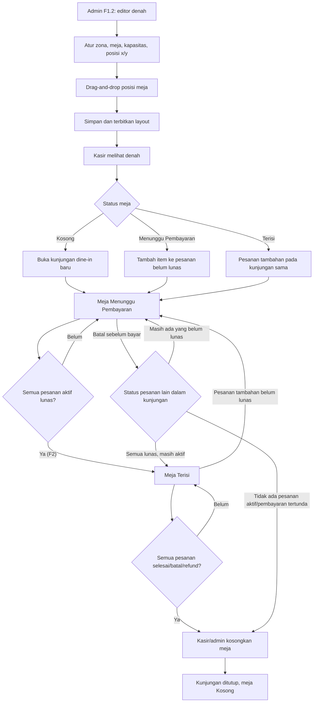

### 7.5 Kondisi berhasil, gagal, dan batal

| Kondisi | Hasil |
| --- | --- |
| **Berhasil memilih meja Kosong** | Kunjungan dine-in baru dibuka; meja **Menunggu Pembayaran** |
| **Tiga status meja** | F1.2 merender Kosong/Menunggu Pembayaran/Terisi dari data uji terkontrol |
| **Transisi ke Menunggu Pembayaran** | Diuji F1.3 saat pesanan belum lunas disimpan |
| **Transisi ke Terisi** | Diuji F2 setelah semua pesanan aktif lunas |
| **Meja aktif dengan pesanan lunas** | Pesanan tambahan pada kunjungan yang sama |
| **Meja aktif dengan pesanan belum lunas** | Item ditambahkan ke pesanan tersebut, bukan order baru |
| **Meja aktif dipakai kunjungan baru tidak terkait** | Ditolak |
| **Pembatalan pesanan belum lunas** | Alasan wajib, audit; meja **Kosong** hanya bila tidak ada pesanan aktif lain/pembayaran tertunda |
| **Pembatalan dengan pesanan aktif lain** | Meja tidak dikosongkan; status mengikuti pesanan tersisa |
| **Menutup meja dengan pesanan aktif** | Ditolak |
| **Menutup meja dengan pembayaran tertunda** | Ditolak |
| **Override admin** | Hanya setelah pesanan aktif/pembayaran tertunda diselesaikan; konfirmasi dan audit |
| **Zona belum diatur** | Default **Utama** |
| **Meja dengan riwayat pesanan** | Tidak dihapus permanen; dinonaktifkan |

---

## 8. Queue Flow

### 8.1 Status

| Bagian | Status |
| --- | --- |
| Halaman publik `/queue` | ✅ F0 (shell/empty state) |
| Pembuatan nomor antrean | 🟡 F2 |
| Papan antrean real-time | 🟡 F3 |
| Privasi papan antrean | ✅ Prinsip F0, diuji pada F3 |

### 8.2 Alur normal

1. Nomor antrean **tidak dibuat saat pesanan disimpan**.
2. Nomor dibuat setelah pembayaran **Lunas**.
3. Format huruf + tiga digit, contoh `A001`; bila melewati 999, digit boleh
   bertambah tanpa mengubah prefiks.
4. Nomor direset setiap hari berdasarkan `Asia/Jakarta`, memakai
   `daily_sequences`.
5. Nomor unik per tanggal bisnis; pembuatan atomik dan aman terhadap dua
   pembayaran bersamaan.
6. Setiap pesanan hanya memiliki satu nomor antrean aktif. Nomor yang sudah
   dipakai tidak boleh digunakan ulang.
7. Nomor ditampilkan di struk, layar konfirmasi pembayaran, papan antrean
   publik, dan KDS.
8. Papan publik hanya menampilkan nomor, status, dan waktu pembaruan.
9. Status antrean mengikuti status KDS: **Pesanan Masuk**, **Sedang Disiapkan**,
   **Siap Diambil**.
10. Setelah kasir/admin mengonfirmasi pengambilan, pesanan **Selesai** dan
    hilang dari papan antrean. Riwayat tetap tersimpan untuk laporan.
11. Pesanan tambahan yang lunas mendapat nomor antrean baru; nomor pesanan
    sebelumnya tidak berubah.

### 8.3 Diagram

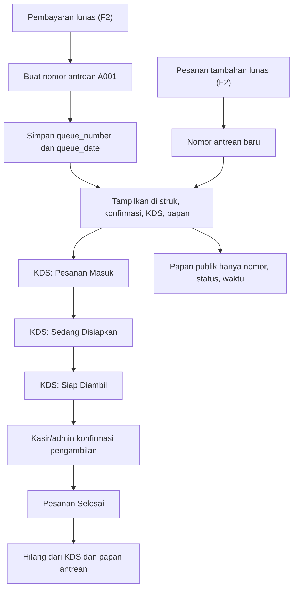

### 8.4 Kondisi berhasil, gagal, dan batal

| Kondisi | Hasil |
| --- | --- |
| **Berhasil** | Nomor unik dibuat sekali setelah lunas dan tampil di semua kanal |
| **Pesanan belum lunas** | Tidak memiliki nomor antrean |
| **Klik ganda/retry/webhook duplikat** | Idempotency dan unique constraint mencegah nomor ganda |
| **Dua pembayaran bersamaan** | Pembuatan nomor atomik; tidak ada duplikasi |
| **Pesanan tambahan** | Nomor baru; nomor lama tidak berubah/dipakai ulang |
| **Pesanan selesai** | Hilang dari papan; riwayat tetap ada |
| **Refund penuh setelah lunas** | Antrean dihentikan dan hilang dari papan aktif bila masih berjalan; riwayat tetap tersimpan |
| **Papan publik** | Tidak menampilkan nama, telepon, meja, nominal, atau metode pembayaran |
| **Konfirmasi pengambilan dari papan publik** | Tidak tersedia; papan publik hanya menampilkan nomor, status, dan waktu |

---

## 9. Refund and Cancellation Flow

### 9.1 Status

| Bagian | Status |
| --- | --- |
| Pembatalan pesanan **Menunggu Pembayaran** tanpa pembayaran | 🟡 F1.3 |
| Pembatalan pesanan **Sebagian Dibayar** setelah refund bagian | 🟡 F2 |
| Refund sebagian/penuh | 🟡 F2 |
| Approval refund penuh setelah lunas | 🟡 F2 |
| Pencatatan notifikasi refund | 🟡 F2 |
| Penghentian tiket KDS dan tampilan notifikasi | 🟡 F3 |
| Dampak kas/shift refund | 🟡 F5 |

### 9.2 Pembatalan sebelum lunas

**F1.3 — pesanan belum dibayar**

1. Pesanan berstatus **Menunggu Pembayaran** dan belum memiliki pembayaran.
2. Kasir atau admin membatalkan pesanan dengan memilih alasan wajib dan
   konfirmasi eksplisit. Kitchen tidak dapat membatalkan.
3. Pesanan menjadi **Dibatalkan** dan bersifat final; pesanan tidak dapat
   diaktifkan kembali. Bila pelanggan tetap memesan, buat pesanan baru.
4. Karena belum lunas, tidak ada nomor antrean dan tidak ada tiket KDS yang
   dibuat atau dihentikan.
5. Bila tidak ada pesanan aktif lain dan tidak ada pembayaran tertunda, kasir/
   admin dapat menutup kunjungan dan meja kembali **Kosong**. Bila masih ada
   pesanan aktif lain, status meja mengikuti pesanan tersebut.
6. Aktor, waktu, alasan, pesanan, meja/kunjungan, grand total, dan status
   sebelumnya dicatat di audit.
7. Klik ganda/retry tidak boleh membatalkan dua kali atau membuat audit ganda.

**F2 — pesanan sudah dibayar sebagian**

1. Pesanan berstatus **Sebagian Dibayar**.
2. Pembatalan hanya dapat dilanjutkan setelah refund bagian disetujui dan
   dicatat admin.
3. Setelah refund bagian tercatat, pesanan menjadi **Dibatalkan**; tidak ada
   nomor antrean/tiket KDS yang perlu dihentikan.
4. Meja dapat dikosongkan bila tidak ada pesanan aktif lain dan tidak ada
   pembayaran tertunda.
5. Seluruh aksi refund, approval, pembatalan, dan dampak meja dicatat di audit.

### 9.3 Refund setelah pembayaran (F2.4 Contract)

1. Refund hanya dapat diproses oleh pengguna dengan role **admin**. Kasir hanya dapat melihat status riwayat.
2. Admin membuka modal refund dari detail pesanan di POS (`RefundModal`), memilih:
   - Tipe refund: **Penuh (Full)** atau **Sebagian (Partial)**.
   - Metode refund: **Tunai**, **QRIS Manual**, **Transfer**, atau **Midtrans**.
   - Pada pesanan split bill: admin dapat memilih spesifik baris pembayaran (`payment_id`) yang direfund.
   - Nominal refund (wajib positif dan tidak melebihi sisa dana yang tersedia).
   - Alasan refund (wajib diisi minimal 3 karakter).
3. **Pencegahan Over-Refund & Pending Overlap**:
   - Sistem memvalidasi saldo yang dapat direfund secara atomik: $\text{paid\_total} - (\text{refunded\_total} + \sum \text{pending\_refunds})$.
   - Jika ada refund Midtrans yang masih berstatus `pending`, nominalnya otomatis memotong batas dana yang tersedia agar tidak terjadi tumpang tindih permintaan paralel.
4. **Alur Metode Non-Midtrans (Tunai, QRIS Manual, Transfer)**:
   - Refund langsung dieksekusi dengan status `completed`.
   - `approved_by` diisi ID admin dan `approved_at` diisi timestamp saat ini.
   - Nominal refund langsung ditambahkan ke `orders.refunded_total`.
5. **Alur Metode Midtrans Gateway**:
   - Refund pertama kali dicatat dengan status `pending`.
   - `approved_by` dan `approved_at` tetap `NULL` untuk mencegah klaim persetujuan sebelum gateway berhasil.
   - Konfirmasi refund dilakukan melalui RPC `confirm_midtrans_refund_atomic` (`service_role` only) setelah API Midtrans atau webhook memberikan konfirmasi resmi dengan `gateway_refund_id`.
   - Setelah dikonfirmasi, status menjadi `completed`, approver dan approved_at diisi, serta saldo refund ditambahkan ke `orders.refunded_total`.
6. **Refund Sebagian (Partial)**:
   - Pesanan tetap berstatus `paid` atau `completed`.
   - Tiket KDS tidak berubah.
   - Jika menargetkan pembayaran tertentu pada split bill, status pembayaran berubah menjadi `refunded` jika dan hanya jika total akumulasi refund pada pembayaran tersebut telah mencapai nilai pembayaran.
7. **Refund Penuh (Full)**:
   - Status pesanan berubah menjadi `refunded`.
   - Jika tiket KDS masih aktif, tiket dihentikan (`orders.kds_status = NULL`), `cancelled_at` dan `cancelled_by` diisi, serta `refunds.kitchen_notified_at` diisi timestamp saat ini.
   - Antrean dihentikan.
8. Seluruh tindakan refund, penolakan, idempotensi, dan konfirmasi gateway dicatat secara lengkap pada `audit_logs`.

### 9.4 Diagram

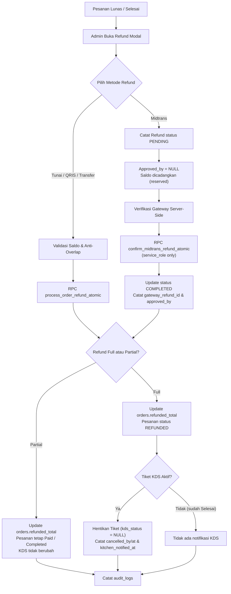

### 9.5 Kondisi berhasil, gagal, dan batal

| Kondisi | Hasil |
| --- | --- |
| **Batal sebelum bayar** | **Dibatalkan**; alasan wajib; audit; tanpa antrean/KDS; meja **Kosong** hanya bila tidak ada pesanan aktif lain/pembayaran tertunda |
| **Batal oleh kitchen** | Ditolak |
| **Batal tanpa alasan** | Ditolak |
| **Batal setelah pembayaran sebagian** | F2: **Dibatalkan** setelah refund bagian disetujui/dicatat admin |
| **Batal setelah lunas** | Tidak boleh **Dibatalkan**; harus refund |
| **Refund sebagian** | Pesanan tetap **Lunas** atau **Selesai**; KDS tidak berubah |
| **Refund penuh sebelum lunas** | **Dibatalkan**; tidak ada antrean/KDS; pengembalian dana (bila ada) dicatat |
| **Refund penuh setelah lunas** | Wajib approval admin; tiket dan antrean dihentikan bila masih aktif; kitchen diberi notifikasi |
| **Refund penuh setelah Selesai** | Pesanan **Refund**; tiket KDS sudah tidak aktif; tetap diaudit |
| **Approval non-admin** | Ditolak |
| **Refund tanpa alasan** | Tidak boleh diproses |
| **Refund tunai tanpa shift** | Admin mencatat pengeluaran tunai di luar shift |
| **Refund ditolak** | Tiket KDS tetap berjalan; penolakan diaudit |

---

## 10. Additional Order Flow

### 10.1 Status

| Bagian | Status |
| --- | --- |
| Model data kunjungan dan pesanan | 🟡 F1.3 |
| Alur pesanan tambahan setelah lunas | 🟡 F2 |
| Nomor antrean baru dan tiket KDS baru | 🟡 F2 |

### 10.2 Prasyarat

- Pesanan sebelumnya sudah **Lunas**.
- Pelanggan masih berada pada meja dan kunjungan dine-in yang sama.
- Tidak ada pesanan belum lunas pada kunjungan tersebut. Bila masih ada,
  penambahan item dilakukan pada pesanan yang sama, bukan pesanan baru.

### 10.3 Alur normal

1. Kasir memilih meja yang masih memiliki kunjungan aktif.
2. Sistem memakai `dining_session_id` yang sama dan membuat **ID pesanan baru**.
3. Kasir menambahkan produk, modifier, dan catatan.
4. Pesanan disimpan sebagai **Menunggu Pembayaran**; meja kembali **Menunggu
   Pembayaran**.
5. Kasir memproses pembayaran pesanan tambahan.
6. Setelah lunas, sistem membuat **nomor antrean baru** dan **tiket KDS baru**.
7. Nomor antrean, tiket KDS, dan status pesanan sebelumnya **tidak berubah**.
8. Bila pesanan tambahan dibatalkan sebelum bayar, hanya pesanan tambahan yang
   **Dibatalkan**; pesanan sebelumnya tetap.
9. Idempotency key dan transaksi database mencegah pesanan/antrean ganda.

### 10.4 Diagram

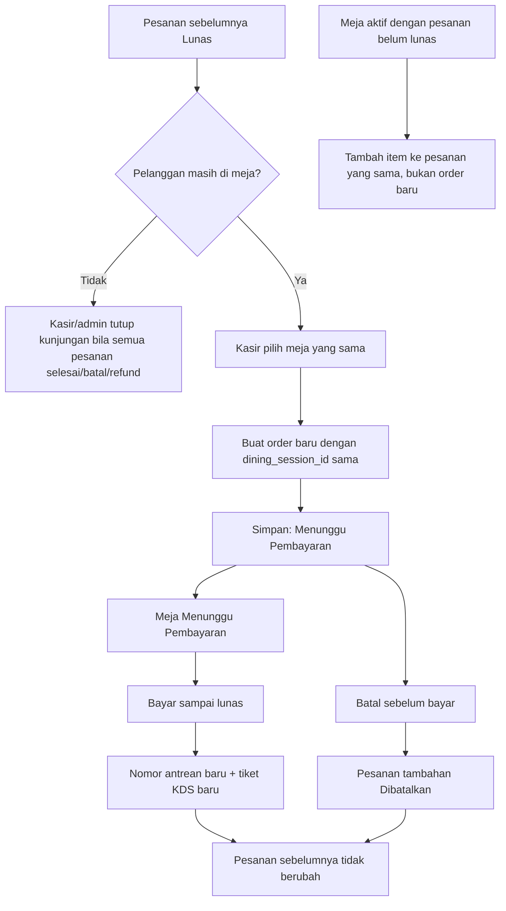

### 10.5 Kondisi berhasil, gagal, dan batal

| Kondisi | Hasil |
| --- | --- |
| **Berhasil** | Order baru, nomor antrean baru, tiket KDS baru; order lama tidak berubah |
| **Pesanan sebelumnya belum lunas** | Item ditambahkan ke pesanan yang sama, bukan order baru |
| **Klik ganda/retry** | Idempotency mencegah order/antrean ganda |
| **Pesanan tambahan dibatalkan** | Hanya pesanan tambahan yang batal; pesanan sebelumnya tetap |
| **Meja/kunjungan berbeda** | Ditolak; pesanan tambahan harus pada kunjungan yang sama |
| **Nomor antrean lama** | Tidak boleh dipakai ulang atau ditimpa |

---

## 11. Authentication and Authorization Flow

### 11.1 Status

| Bagian | Status |
| --- | --- |
| Login username/password | ✅ F0 |
| Role admin/kasir/kitchen | ✅ F0 |
| Guard rute | ✅ F0 |
| Sesi idle | ✅ F0 |
| Rate limit dan lockout | ✅ F0 |
| Manajemen pengguna | ✅ F0 |
| RLS dan service role server-only | ✅ F0 |
| Modul per role | 🟡 F1–F6 |

### 11.2 Alur login staf

1. Staf membuka `/login`.
2. Staf memasukkan username dan password. Username dipetakan ke email sintetis
   `username@saji.app`; ini bukan branding yang ditampilkan.
3. Sistem memeriksa kredensial dan profil aktif.
4. Bila gagal, pesan error dibuat generik agar tidak membocorkan username valid.
5. Lima kegagalan dalam 15 menit memicu lockout 15 menit, dihitung per username
   dan per IP (IP disimpan sebagai hash).
6. Bila akun nonaktif, profil hilang, atau role tidak valid, login ditolak dengan
   pesan yang sesuai.
7. Bila berhasil, staf diarahkan ke halaman awal sesuai role:
   - admin → `/admin`,
   - kasir → `/pos`,
   - kitchen → `/kitchen`.
8. `next` hanya diterima bila berupa path internal dan role memiliki akses.
9. Sesi otomatis berakhir setelah `SESSION_IDLE_MINUTES` tanpa aktivitas
   (default 30 menit) dan diarahkan ke `/login?reason=idle`.
10. Role yang salah saat membuka rute akan diarahkan ke `/unauthorized`.

### 11.3 Alur otorisasi

| Rute | Admin | Kasir | Kitchen | Publik |
| --- | --- | --- | --- | --- |
| `/login` | ✓ | ✓ | ✓ | ✓ |
| `/queue` | ✓ | ✓ | ✓ | ✓ |
| `/admin` | ✓ | — | — | — |
| `/admin/users` | ✓ | — | — | — |
| `/pos` | ✓ | ✓ | — | — |
| `/kitchen` | ✓ | — | ✓ | — |
| `/unauthorized` | ✓ | ✓ | ✓ | — |

Aturan tambahan:

- RLS aktif pada seluruh tabel F0.
- Profil hanya dapat dibaca sendiri oleh staf aktif atau admin.
- Audit log dan percobaan login hanya dapat dibaca admin.
- Penulisan audit/login attempts melalui service role.
- Service role key hanya di server dan tidak pernah masuk bundle browser.
- Peran disimpan di `profiles` dan dicerminkan ke `app_metadata` untuk
  pengecekan cepat di proxy; server tetap memakai `profiles` sebagai sumber
  kebenaran.
- Admin tidak dapat menonaktifkan dirinya sendiri; admin aktif terakhir tidak
  dapat dinonaktifkan atau diturunkan perannya.
- Semua tindakan istimewa dicatat di `audit_logs`.

### 11.4 Diagram

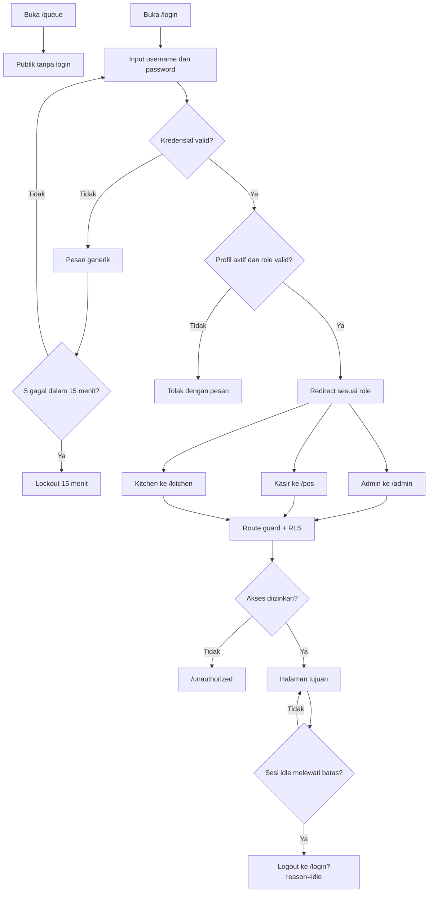

### 11.5 Kondisi berhasil, gagal, dan batal

| Kondisi | Hasil |
| --- | --- |
| **Berhasil login** | Redirect ke halaman awal sesuai role |
| **Password salah** | Pesan generik; percobaan dicatat |
| **Akun nonaktif/profil hilang/role invalid** | Login ditolak |
| **5 kegagalan dalam 15 menit** | Lockout 15 menit per username/IP |
| **Sesi idle** | Logout dan redirect ke login |
| **Role salah membuka rute** | Redirect `/unauthorized` |
| **Admin menonaktifkan diri sendiri** | Ditolak |
| **Admin aktif terakhir dinonaktifkan** | Ditolak |
| **Akses service role dari client** | Tidak mungkin; modul server-only |

---

## 12. Hubungan antarrole dan perpindahan data

### 12.1 Hubungan antarrole

| Dari | Ke | Data/aksi | Kapan |
| --- | --- | --- | --- |
| Pelanggan | Kasir | Tipe pesanan, item, modifier, catatan, pembayaran | Saat memesan dan membayar |
| Kasir | POS/order | Pesanan, item, diskon, kunjungan, meja | F1.1–F1.4 |
| Kasir | Pembayaran | Metode, nominal, split bill, referensi, status | F2 |
| Pembayaran | Antrean/KDS | Nomor antrean, tiket KDS, status lunas | Setelah lunas F2 |
| Kitchen | KDS | Status Pesanan Masuk → Sedang Disiapkan → Siap Diambil | F3 |
| Kitchen | Kasir/Pelanggan | Sinyal pesanan **Siap Diambil** melalui papan/KDS | F3 |
| Kasir/Admin | Pelanggan | Konfirmasi pengambilan, pesanan **Selesai** | F3 |
| Admin | Kasir | Master menu/harga, meja, approval diskon | F1.1–F1.4 |
| Admin | Kasir | Pembatalan pesanan belum lunas | F1.3 |
| Admin | Kasir/Kitchen | Approval refund, penghentian tiket, notifikasi | F2/F3 |
| Admin | Laporan | Data transaksi, pembayaran, refund, stok, shift | F6 |
| Publik | Papan antrean | Nomor, status, waktu | F3 |

### 12.2 Diagram hubungan role

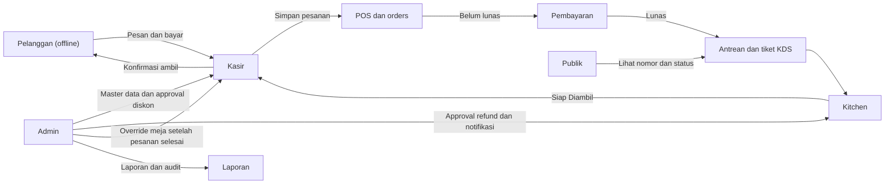

### 12.3 Perpindahan data dari POS ke pembayaran, KDS, dan antrean

| Tahap | Aktor | Data utama | Status fase |
| --- | --- | --- | --- |
| Login | Staf | `profiles`, sesi, audit login | ✅ F0 |
| Simpan pesanan | Kasir | `orders`, `order_items`, `order_item_modifiers`, `dining_sessions`, `table_id` | 🟡 F1.3 |
| Diskon | Kasir/Admin | `order_discounts`, approval, approver, snapshot | 🟡 F1.4 |
| Status awal | Sistem | Pesanan **Menunggu Pembayaran**; meja **Menunggu Pembayaran** untuk dine-in; belum ada antrean/KDS | 🟡 F1.3 |
| Handoff pembayaran | Sistem/Kasir | `order_id` dan status **Menunggu Pembayaran**; tanpa baris pembayaran | 🟡 F1.3/F2 |
| Pembatalan belum lunas | Kasir/Admin | `orders.status = dibatalkan`, alasan, aktor, audit, dampak meja | 🟡 F1.3/F2 |
| Pembayaran | Kasir | `payments`, metode, sumber, nominal, referensi, `midtrans_order_id`, `gateway_transaction_id`, status | 🟡 F2 |
| Split bill | Kasir | Beberapa baris `payments`; total tidak melebihi grand total | 🟡 F2 |
| Lunas | Sistem | `paid_total = grand_total`; nomor antrean; data tiket KDS | 🟡 F2 |
| KDS | Kitchen | Status KDS, waktu masuk/mulai/siap, riwayat status | 🟡 F2/F3 |
| Papan antrean | Publik | Nomor, status, waktu pembaruan | 🟡 F3 |
| Pengambilan | Kasir/Admin | Pesanan **Selesai**; tiket dihapus dari papan | 🟡 F3 |
| Refund | Admin | `refunds`, approval, alasan, notifikasi dapur, audit | 🟡 F2/F3 |
| Stok | Admin/Sistem | `stock_movements` | 🟡 F4 |
| Shift | Kasir/Admin | `shifts`, `cash_movements` | 🟡 F5 |
| Laporan | Admin | View/laporan, export, audit lanjutan | 🟡 F6 |

### 12.4 Aturan data yang tidak boleh dilanggar

- Pesanan **belum lunas** tidak boleh memiliki nomor antrean atau tiket KDS.
- F1 tidak boleh mencatat pembayaran, mengubah pesanan menjadi **Lunas**,
  membuat nomor antrean, atau membuat tiket KDS.
- Handoff F1.3 ke F2 memakai `order_id` yang sama; F2 tidak membuat pesanan atau
  kunjungan baru.
- Pembatalan pesanan belum lunas wajib alasan dan audit; pesanan **Dibatalkan**
  tidak dapat diaktifkan kembali.
- Meja hanya dikosongkan bila tidak ada pesanan aktif lain dan tidak ada
  pembayaran tertunda.
- Nomor antrean dibuat tepat sekali per pesanan dan unik per tanggal bisnis.
- Setiap pesanan dalam satu kunjungan memiliki status, pembayaran, nomor
  antrean, dan tiket KDS sendiri.
- Pesanan tambahan tidak mengubah pesanan/antrean/tiket sebelumnya.
- Perubahan status pesanan, pembayaran, meja, KDS, dan antrean harus tercatat.
- Data pelanggan dan keuangan tidak boleh muncul di `/queue`.

---

## 13. Matriks kondisi berhasil, gagal, dan pembatalan

| Proses | Berhasil | Gagal | Batal |
| --- | --- | --- | --- |
| Login staf | Redirect sesuai role | Kredensial salah, akun nonaktif, role invalid, lockout | Sesi idle/logout |
| Simpan pesanan | **Menunggu Pembayaran**, meja diperbarui untuk dine-in | Validasi gagal, klik ganda dicegah idempotency | Dibatalkan sebelum bayar dengan alasan wajib dan audit |
| Handoff pembayaran | Konfirmasi **Menunggu Pembayaran** + CTA placeholder F1; aktif di F2 dengan `order_id` sama | Panel pembayaran dibuka di F1 ditolak | Kembali ke POS/denah atau batalkan belum lunas |
| Pembatalan belum lunas | **Dibatalkan**, audit, meja mengikuti pesanan tersisa | Kitchen/alasan kosong/pesanan lunas ditolak | Meja **Kosong** hanya bila tidak ada pesanan aktif/pembayaran tertunda |
| Status meja | F1.2 merender tiga status; F1.3 transisi menunggu pembayaran; F2 transisi Terisi | Transisi tanpa pembayaran ditolak | Batal belum lunas mengembalikan meja bila tidak ada pesanan aktif |
| Diskon manual | Disetujui admin dan diterapkan | Ditolak/ belum disetujui | Tidak diterapkan |
| Pembayaran tunai | Pembayaran dicatat, kembalian dihitung | Nominal tidak valid | Pesanan tetap belum lunas |
| QRIS Manual/transfer | Dicatat setelah konfirmasi kasir | Referensi tidak valid | Pesanan tetap belum lunas |
| QRIS Midtrans/Midtrans | Webhook valid, status terverifikasi | Signature invalid, expired, gagal | Tidak ada antrean/KDS |
| Split bill | Total = grand total, **Lunas** | Non-tunai melebihi sisa, total melebihi tagihan | Pembayaran dihentikan, pesanan belum lunas |
| Masuk KDS | Hanya setelah lunas | Pesanan belum lunas ditolak | Refund penuh menghentikan tiket bila masih aktif |
| Status KDS | Tiga status berurutan | Lompat status ditolak | Refund penuh setelah lunas |
| Pengambilan | Kasir/admin konfirmasi, **Selesai** | Kitchen mencoba konfirmasi, ditolak | Refund penuh sebelum pengambilan |
| Tutup meja | Semua pesanan selesai, meja **Kosong** | Masih ada pesanan/pembayaran tertunda | Batal sebelum bayar mengembalikan meja |
| Pesanan tambahan | Order/antrean baru, order lama tetap | Meja/kunjungan salah ditolak | Pesanan tambahan batal, order lama tetap |
| Refund | Admin approval, audit, notifikasi | Non-admin/ditolak | Refund penuh setelah lunas menghentikan tiket/antrean bila masih aktif |
| Nomor antrean | Dibuat sekali setelah lunas | Duplikat dicegah idempotency/unique | Tidak ada nomor bila belum lunas |

---

## 14. Batasan, non-goals, dan referensi

### 14.1 Non-goals yang tidak boleh ditambahkan

- QR ordering atau pemesanan mandiri dari meja.
- Aplikasi pelanggan, akun pelanggan, atau loyalty program.
- Reservasi meja online.
- Marketplace atau integrasi delivery pihak ketiga.
- Manajemen multi-cabang pada fase awal.
- Mode offline penuh.
- Penggantian mesin kasir fiskal/EDC di luar integrasi pembayaran yang
  dinyatakan di PRD.

### 14.2 Larangan alur

- Jangan mengirim pesanan ke KDS sebelum lunas.
- Jangan membuat nomor antrean sebelum lunas.
- Jangan menambah status KDS keempat.
- Jangan memberi kitchen aksi konfirmasi pengambilan.
- Jangan menampilkan nama, telepon, meja, nominal, atau metode pembayaran di
  `/queue`.
- Jangan mengizinkan kasir mengubah harga produk secara bebas.
- Jangan memproses diskon manual tanpa approval admin.
- Jangan memproses refund tanpa admin.
- Jangan membuat pesanan/antrean ganda akibat klik ganda atau retry.
- Jangan mencatat pembayaran, membuat nomor antrean, atau membuat tiket KDS
  pada F1.
- Jangan membuka panel pembayaran di F1; gunakan konfirmasi dan CTA
  placeholder.
- Jangan membatalkan pesanan tanpa alasan atau oleh kitchen.
- Jangan menandai meja **Terisi** sebelum pembayaran lunas.

### 14.3 Referensi

- [`docs/PRD.md`](./PRD.md) — requirement produk, state machine, aturan
  perhitungan, analisis database, konflik, dan acceptance criteria.
- [`docs/ROADMAP.md`](./ROADMAP.md) — fase F0–F6, deliverable, migration,
  dependency, gate, dan risiko.
- [`README.md`](../README.md) — setup, keamanan, dan ringkasan operasional.
- Kode F0: `src/app/login/page.tsx`, `src/app/queue/page.tsx`,
  `src/app/(app)/admin/page.tsx`, `src/app/(app)/admin/users/page.tsx`,
  `src/lib/auth/roles.ts`, `src/lib/auth/guards.ts`, `src/proxy.ts`.

### 14.4 Change log

| Versi | Tanggal | Perubahan |
| --- | --- | --- |
| 1.0 | 11 November 2026 | Dokumen alur awal: customer, cashier, kitchen, admin, order, payment, table, queue, refund/cancellation, additional order, dan authentication/authorization; status F0–F6 dan diagram Mermaid |
| 1.1 | 11 November 2026 | Audit konsistensi pra-F1: perbaiki refund setelah lunas/Selesai, pencatatan tunai split bill, transisi meja saat pembatalan, arti override tutup meja, fase notifikasi refund, dan status pembayaran |
| 1.2 | 11 November 2026 | Selaraskan dengan PRD/ROADMAP 1.5: status F1.1–F1.4, pembatalan pesanan belum lunas (role, alasan, audit, dampak meja), handoff POS ke pembayaran F2, tiga status meja (render F1.2, transisi Terisi F2), dan larangan KDS/antrean pada F1 |
